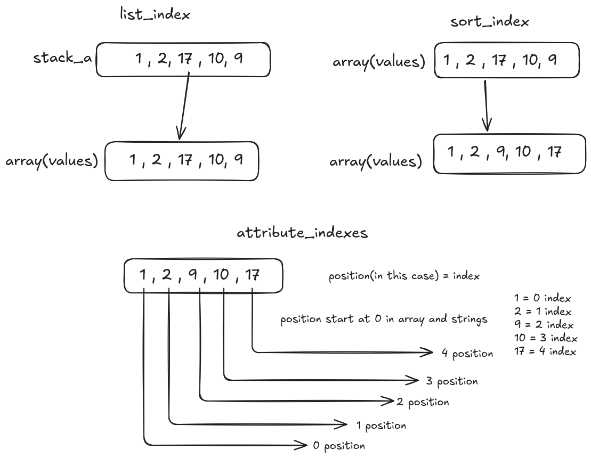
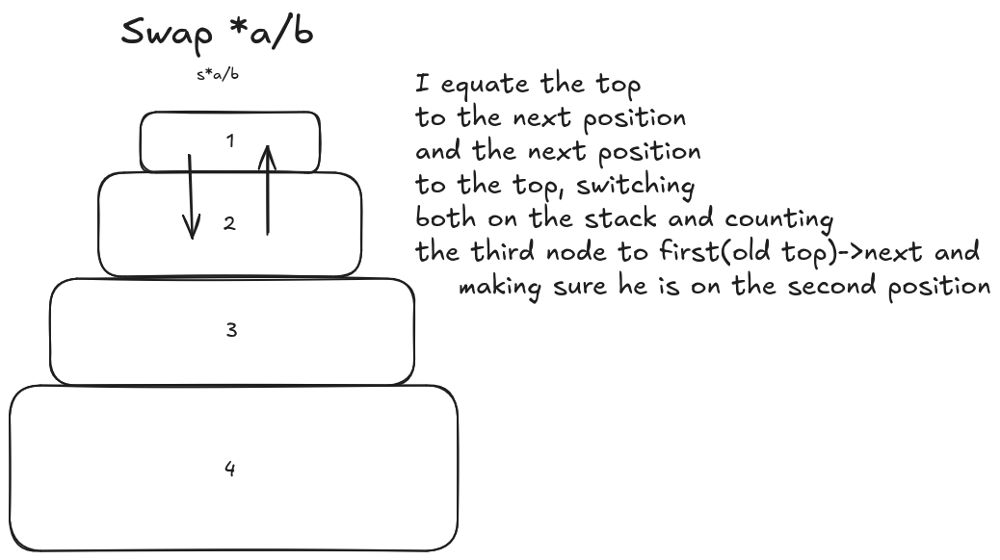
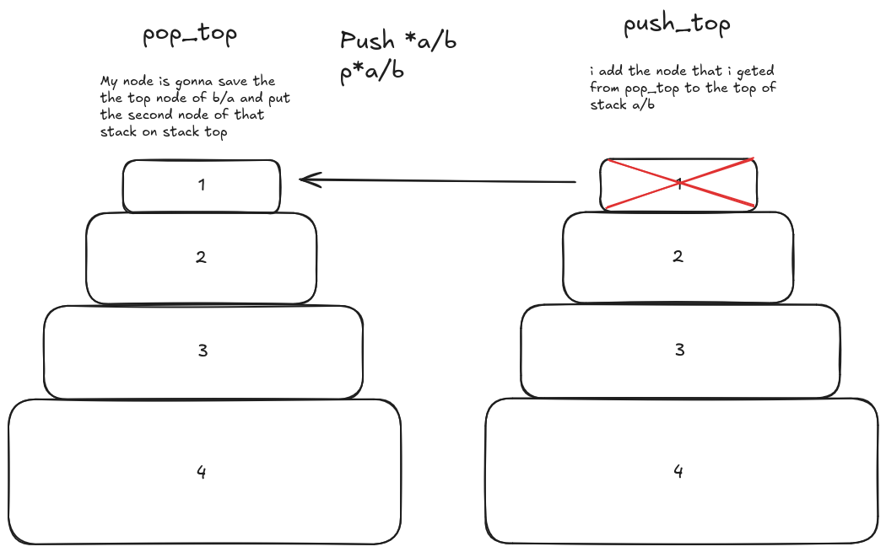
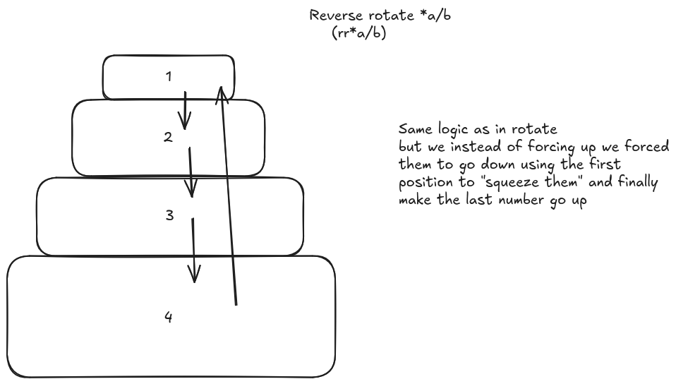
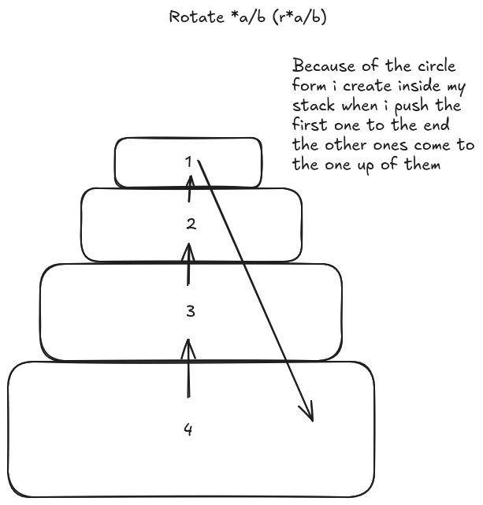
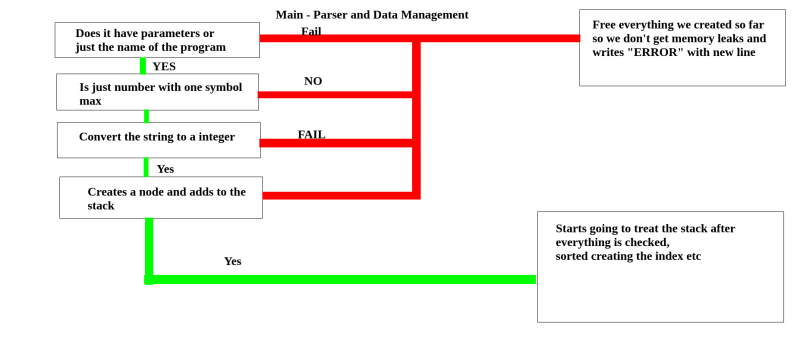

*This project has been created as part of the 42 curriculum by pneto-vi , nfardim.*

# Description

Push_swap is a 42 School project that sorts a stack of integers using two stacks and a limited set of operations, outputting the smallest possible sequence of instructions.

This implementation provides **4 sorting strategies** and **benchmark mode**. The stacks are implemented as **circular doubly linked lists**, where rotations are O(1) pointer moves and push/pop operations simply rewire pointers without copying data.

# Project Structure

```
.
├── main.c                    # entry point, init_stacks, run_algorithm dispatcher
├── push_swap.h               # all struct definitions and function prototypes
├── Makefile                  # compilation rules
├── README.md                 # this file
├── img/                      # images for documentation
├── libft/
│   ├── ft_atoi.c             # string → long conversion
│   └── ft_split.c            # string splitter (5 functions: count_words, word_len, get_word, add_word, ft_split)
├── ops/
│   ├── stack_ops.c           # create_new, stack_add_node, stack_push_top, stack_pop_top, free_stack
│   ├── push_pop_ops.c        # pa, pb
│   ├── swap_ops.c            # sa, sb, swap_nodes, ss
│   ├── rotate_ops.c          # ra, rb, rr
│   └── rev_rotate_ops.c      # rra, rrb, rrr
├── parse/
│   ├── parser.c              # check_duplicates, is_a_number, parse_number, error_exit, parse_flags
│   └── parse_utils.c         # parse_split, parse_input, strcmp
├── sort/
│   ├── check_sorted.c        # is_sorted
│   ├── simple_sort.c         # simple_algorithm
│   ├── medium_sort.c         # find_max_in_b, insert_from_b, push_chunk_to_b, sort_stack_a, medium_algorithm
│   ├── complex_sort.c        # complex_algorithm
│   └── disorder.c            # count_inv_from, calculate_disorder, choose_algorithm
└── utils/
    ├── utils.c               # print_stack_a
    ├── index_utils.c         # sort_index, atribute_indexs, list_index
    ├── math_utils.c          # int_sqrt, in_range
    └── bench_print.c         # print_bench

``` 
## 1. Circular Stack Architecture

The stack implementation follows a **Circular Doubly Linked List** model. Unlike a standard array where elements are stored in contiguous memory blocks, this architecture relies on nodes "holding hands" through `next` and `prev` pointers.  

*   **Memory Efficiency:** No need to shift elements; operations like rotate only require moving the `top` pointer.  
*   **The "Pyramid" Logic:** My `stack_add_node` function implements a bottom-loading strategy.  
    *   The first argument remains at the top.  
    *   New arguments are inserted between the current last node and the top, growing the "pyramid" downwards while keeping the circular connection intact.  

## 2. Node Management

*   **Initialization (`create_new`):** Each node is safely allocated using `malloc`.  
    *   `index` is set to `-1` as a placeholder for the future coordinate compression/indexing phase.  
    *   Pointers are initialized to `NULL` to prevent "garbage" data issues.  
*   **Size Tracking:** The `sort_stack` structure maintains a `size` attribute. This is crucial for iterating through the circular list without falling into infinite loops.  

## 3. Error Handling & Validation

*   **Duplicate Detection (`check_duplicates`):** A dedicated validation function ensures that no two numbers in the stack are identical.  
*   **The 42 Standard (Exit Strategy):**
    *   If a duplicate or invalid input is found, the program must output `Error\n` to the **Standard Error (stderr)**.  
    *   **Memory Integrity:** Before the program exits on an error, a cleanup function must free all previously allocated nodes to ensure zero memory leaks (as required by the project subject).
# stack_add_node 
The function that adds a new node to the "pyramid" (the stack of nodes). It always keeps the `new_node` at the lower part of the pyramid. It can be visualized in other ways, but this was the one I created in my head.


# Indexing

*   **List (`list_index`):** 
    It allocates memory for an array that will contain all values inside the stack. With the help of a loop, we save all the values, and then with the next function, we organize them.

*   **Sort (`sort_index`):** 
    This function organizes the values in ascending order using a loop that checks if any subsequent number is smaller than the current one. Repeating this for all numbers results in a sorted array.

*   **Attribute (`attribute_indexes`):** 
    In this function, we assign the correct index to each node. We use a loop to check if a node's value matches a value in the sorted array, attributing the corresponding index until every node is processed.



# Split 

The `split` function makes it possible to handle input as a single string (e.g., `"1 2 4"`) instead of being restricted to the format `./push_swap 1 2 4`, as it removes all spaces between the numbers and processes them individually.

# Sorting Operations

We created different functions to sort the stack, each with its own purpose:

*   **s\* (Swap):** 
    Swaps the first two numbers by manipulating the `top` position and `top->next`.
    

*   **p\* (Push):** 
    Places the first node of one stack onto the other, decreasing the size of the first and increasing the size of the second.
    

*   **rr\* (Reverse Rotate):** 
    Using the circular stack, this is just a matter of moving the `top` pointer to the previous node, pushing everyone "down" except the last one, which moves to the top.
    

*   **r\* (Rotate):** 
    Similar to the one before, but everything moves "up", making the second position the new top.

    

# Parser Functions

*   **Input Parser:** 
    Verifies if the input respects the project rules. It returns an error immediately if it fails, checking for duplicates, letters, or any invalid input.
    

*   **Split Parser:** 
    Creates strings for each number, removing spaces to enable manipulation by other functions.

*   **Flags Parser:** 
    Detects specific flags when executing `push_swap`, making it easier to run tests separately.


# Instructions

### Flags

| Flag | Effect |
|------|--------|
| `--simple` | Force selection sort (O(n²)) |
| `--medium` | Force chunk sort (O(n√n)) |
| `--complex` | Force radix sort (O(n log n)) |
| `--adaptive` | Auto-select (default) |
| `--bench` | Print stats to stderr |

Strategies are mutually exclusive; `--bench` can combine with any.

## Adaptive Selection (Default)

`choose_algorithm` calculates disorder and picks:

| Disorder | Algorithm | Rationale |
|----------|-----------|-----------|
| < 20% | Simple | Nearly sorted — selection sort finishes fast with minimal overhead |
| 20–50% | Medium | Moderate chaos — chunks balance speed and complexity |
| ≥ 50% | Complex | Fully scrambled — radix guarantees O(n log n) no matter the data |

## The Algorithms

### Simple — O(n²)

Find min in A → rotate to top → pb. Repeat. Then pa all back.

```
A = [3:2] [1:0] [4:3] [2:1]

min=[1:0], ra ra→top, pb → A=[4:3][2:1][3:2]  B=[1:0]
min=[2:1], ra→top, pb   → A=[3:2][4:3]        B=[2:1][1:0]
pb pb                    → A empty             B=[4][3][2][1]
pa pa pa pa              → A=[1][2][3][4] ✓
```

### Medium — O(n√n)

Split A into `√n/2` chunks by index range. For each chunk, scan A: push matching indices to B, ra the rest. Then insert back from B by always taking the highest index (rotate B to bring it to top via shortest path: rb or rrb).

```
n=100: √100/2+1=6 chunks, ~17 indices each

Chunk 0 (idx 0-16): scan A, push if idx<17, else ra
Chunk 1 (idx 17-33): same...
→ B = [85-99][68-84][51-67][34-50][17-33][0-16] (top→bottom)

Insert: find max, if near top→rb, if near bottom→rrb, then pa
→ A gets 99, 98... 0 ✓
```

### Complex (Radix LSD) — O(n log n)

For each bit position (0 to max_bits-1): if `(index>>bit)&1==0`, pb; else ra. Then pa all back.

```
n=4, indices 0(00) 1(01) 2(10) 3(11), max_bits=2

Bit 0: [3:11]→ra [1:01]→ra [4:00]→pb [2:10]→pb → pa→A=[1][3][2][4]
Bit 1: [1:01]→pb [3:11]→ra [2:10]→ra [4:00]→pb → pa→A=[4][1][2][3]
                                                       0  1  2  3  ✓
```

log₂(n) passes. 500 numbers = ~9 passes.


## Benchmark Mode (`--bench`)

When `--bench` is added, the program prints to **stderr**:

```
Disorder: 50.00%
Strategy: complex (O(n log n))
Total ops: 18
sa:0 sb:0 ss:0 pa:8 pb:4 ra:6 rb:0 rr:0 rra:0 rrb:0 rrr:0
```

This goes to stderr so it doesn't interfere with piping to `checker_linux`.

## Random test with benchmark

```
ARG=$(seq -1000 1000 | shuf -n 500 | tr '\n' ' ')
./push_swap --bench $ARG
```

### Validate with checker

```
ARG="4 2 1 3 5"
./push_swap $ARG | ./checker_linux $ARG    # should print "OK"
./push_swap $ARG | ./checker_linux $ARG    # wrong output prints "KO"
```

## Performance Targets

All targets met with the default adaptive strategy:

| Stack size | Target  | Result |
|------------|---------|--------|
| 100        | < 2000 operations | ~800 ops ✅ |
| 500        | < 12000 operations | ~6800 ops ✅ |

# Resources

This project was built incrementally, using previous 42 projects (with different objectives) as a structural foundation for our node and stack architecture. We studied algorithms on **GeeksforGeeks** to understand how they work internally and how to implement them efficiently for our specific needs. The project was deconstructed into independent parts — parsing, stack operations, indexing, and sorting strategies — each built and tested separately before being concatenated. Errors were resolved iteratively with help from colleagues and community forums.